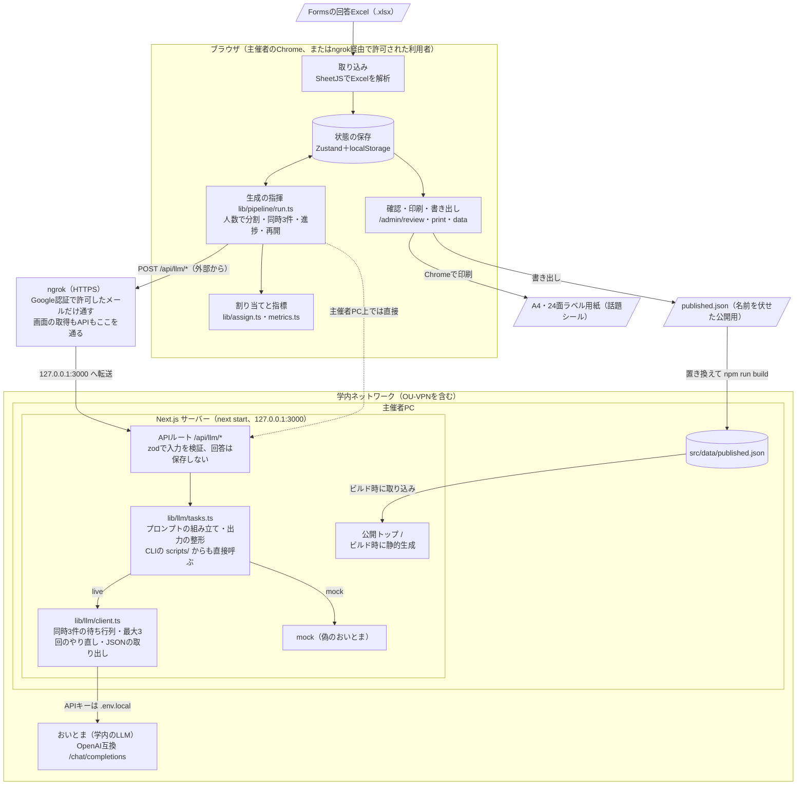

# #おいとま活用中（交流会の名札に「話題」を足すアプリ）

Formsの回答Excelを取り込み、おいとまで「個性タグ1つ＋共有タグ2つ」を作り、A4のラベル用紙に「話題シール」として印刷します。詳しい仕様は `docs/spec.md` を見てください。

実装の確認結果は [実装レビュー](docs/IMPLEMENTATION-REVIEW.md)、管理画面を利用者限定で外部公開する手順は [ngrok手順書](docs/NGROK.md)、次の作業と機能改善の方針は [今後の進め方](docs/IMPROVEMENT-PLAN.md) を参照してください。ngrokで公開トップを更新するときは、`src/data/published.json` の置き換え後にビルドと再起動が必要です。

2026-10-14の運用方針では、Vercelへのデプロイは行わず、学内ネットワークかOU-VPNにつないだPCをngrokで公開します。公開トップ・管理画面・生成APIをGoogle認証で保護し、許可した利用者に全ページを提供します。公開中はPC、アプリ、ngrokを起動し続けます。

おいとまのAPIキーと実際の回答データは、コード・コミット・AIへの指示文に書かないでください。Contributor Free版のAIはプロンプトと出力が学習に使われる条件で動いています。

2026-10-12に画面・印刷を含む `ui` を `main` に統合しました。このREADMEの画面操作とngrok運用は `main` が対象です。起動前に `git switch main` で切り替えてください。開発は引き続き基盤・API・文書を `main`、画面操作・表示・印刷を `ui` で進めます。

## 技術構成

Next.js 16（App Router）・React 19・TypeScript・Tailwind CSS 4・Zustand・zod・SheetJS・Vitest。ngrokで公開する今の運用の構成です。



- **生成の指揮はブラウザ側**：話題の読み取りは8人ずつ、当てはまり順は15人ずつAPIを呼ぶので、1回の呼び出しが短くタイムアウトに強く、途中から再開できます。共有タグの割り当てと人数の検証もブラウザのプログラムが行い、おいとまには言葉の処理（話題の読み取り、候補づくり、当てはまり順、まとめ、別案）だけを任せます。
- **サーバーは中継だけ**：参加者データを保存しません。回答・編集・生成結果は各ブラウザのlocalStorageにあり、ブラウザ間では同期されません。
- **mockとlive**：`LLM_MODE` が未設定なら、`OITOMA_BASE_URL` があればlive、なければmockになります（詳しくは下の「学内のPCでのセットアップ」）。
- **公開トップは静的ページ**：`published.json` をビルド時に取り込むので、置き換えたら `npm run build`（または `npm run verify`）をして `npm start` を起動し直します。

## すぐ試す（おいとまなし）

```bash
npm install
npm run build && npm start
```

Chromeで `http://127.0.0.1:3000/admin` を開きます（`/admin` は `/admin/import` に送ります）。`LLM_MODE` と接続先 `OITOMA_BASE_URL` が未設定なら、偽のおいとま（mock）で全機能が動きます。

## 学内のPCでのセットアップ

おいとまに接続するサーバーPCを、学内ネットワークかOU-VPNにつなぎます。外部の許可ユーザーが操作するときは [ngrok手順書](docs/NGROK.md) に従って公開してください。

```bash
git clone <このリポジトリ>
cd <フォルダ>
npm install
cp .env.example .env.local
```

`.env.local` を編集します（このファイルはgitに入れません）：

```bash
OITOMA_BASE_URL=https://…/ai/v1
OITOMA_API_KEY=<おいとまで発行したキー>
OITOMA_MODEL=qwen3.8-27b-it
```

`OITOMA_API_KEY` が空なら、導入手順で設定したユーザー環境変数 `OKAYAMA_API_KEY` を使います。`OITOMA_JSON_MODE` と `OITOMA_EXTRA_BODY` は分からなければ既定のままでかまいません（受け付けない場合は自動で外して送り直します）。

`LLM_MODE` は通常指定しません。`OITOMA_BASE_URL` が空ならmock、設定済みならliveになります。キーだけを設定してもliveには切り替わりません。接続設定を残して練習するときだけ `LLM_MODE=mock` を指定します。既存の `.env.local` やシェルに `LLM_MODE=mock` がある場合、自動判定を使うにはその指定を削除または解除してください。設定変更はサーバーの再起動で反映され、再ビルドは不要です。

接続先が設定済みでも、サーバーPCが学外でVPNにつながっていない場合などはliveのまま接続に失敗します。通信を最大3回試し、失敗すると学内ネットワークかOU-VPNの確認を案内します。自動でmockへ切り替わることはありません。まとめて生成した途中の結果は保存され、接続を直して「続きから作る」で再開できます。生成後の1人追加は、失敗したら参加者を追加せず、入力を残します。保存済みの結果の読み込み・確認・印刷にはおいとまへの接続は要りません。

## おいとまの接続確認

学内ネットワークかOU-VPNにつないで実行します：

```bash
npm run llm:check
```

モデル一覧、2つのモデルの応答、ダミー3人の話題読み取りを順に試し、最後に `.env.local` に書くとよい値を表示します。すべて成功なら終了コード0です。

## 生成から印刷まで

```bash
npm run build && npm start
```

Chromeで `http://127.0.0.1:3000/admin` を開きます。

1. **取り込み**：Formsの「Excelで開く」で落としたxlsxを選ぶか、「サンプル（15人）で試す」「サンプル（40人）で試す」「サンプル（200人）で試す」で試します。列の割り当てを確かめて「この内容で読み込む」を押します。名前列の自動判定が外れても、列を選び直せます。
2. **生成**：「タグをまとめて作る」を押します。5段階の進捗が出て、終わると候補タグと採用タグが並びます。中止しても終わった分は残り、「続きから作る」で再開できます。
3. **確認**：回答（左）とシール（右）を見比べ、個性タグの書き換えや共有タグの差し替えをします。「おいとまに別案を出してもらう」で個性タグの候補を足せます。
4. **印刷**：A4・24面（66.0×33.9mm）の用紙を使います。普通紙に「位置合わせ用の試し刷り」で全24枠を刷り、ラベル用紙と重ねて位置を合わせてから「印刷する」を押します。横間隔は標準2mmに「すき間の補正」を加えます。Chromeの設定は「送信先：プリンタ（またはPDFに保存）／用紙：A4／余白：なし／倍率：100%／背景のグラフィック：オン」です。刷った用紙は行ごとに切って、左のシールの名前を見て渡します。
5. **保存・バックアップ**：「作業データを保存」でJSONに保存し、別PCでは「保存した作業データを開く」で復元します。「公開ページ用のファイルを書き出す」で `published.json` を作り、運用担当者が `src/data/published.json` を置き換えます。ngrokではビルド・再起動、Vercelではpush後のデプロイで反映します。イベント後は「このPCからデータを消す」を押します。

当日に1人追加するときは「1人分を手入力で追加」タブを使います。生成前は名簿に追加し、生成後は「追加してタグを作る」でその人の分だけ作ります。既存の人のタグは維持されます。「手入力で追加した人のシールを印刷」から追加分を刷れます。使いかけの用紙は「刷り始める段」で指定します。

複数ユーザーの生成は、1つのNode.jsサーバー全体で同時3件まで実行し、残りは最大60件・120秒まで順番に待機します。設定は `.env.example` の `OITOMA_MAX_CONCURRENT`、`OITOMA_QUEUE_LIMIT`、`OITOMA_QUEUE_TIMEOUT_MS` で変えられます。参加者・編集・生成結果はブラウザごとに保存され、同じバックアップを開いても変更は同期されません。

コマンドラインで通すときは次のようにします：

```bash
npm run pipeline -- --file public/samples/sample-40.xlsx --mock --out private/result.json
npm run pipeline -- --mock --file public/samples/sample-40.xlsx --publish src/data/published.json --no-mask
```

## Vercelへのデプロイ（参考・今回の運用では使わない）

1. リポジトリを**個人の**GitHubアカウントに置きます（HobbyプランはOrganizationと接続できません）。
2. Vercelで「Add New → Project」からImportします。Framework PresetはNext.jsのまま。環境変数は設定しません。
3. デプロイ後に `/` が表示され、`/admin/import` が404になることを確かめます。

## 発表の流れ

1. **取り込み**：FormsのExcelを取り込んで見せます（ネット接続は要りません）。
2. **生成**：「保存・バックアップ」で事前に保存した作業データを開き、生成画面の「生成の流れを見る（デモ用）」で5段階を見せます。
3. **確認**：ビフォー・アフターを2〜3人見せ、指標を読み上げます。
4. **印刷**：印刷プレビューと、実際に刷って名札に貼ったシールを見せます。
5. **QR**：スライドのQRから公開トップのデモ用シールを手元のスマホで見てもらいます。

発表用PCでは事前にビルドしておき、ネットを切って読み込み・再生・確認・印刷プレビューまで通ることを確かめます。会場のトラブルに備えてデモの録画も用意します。
