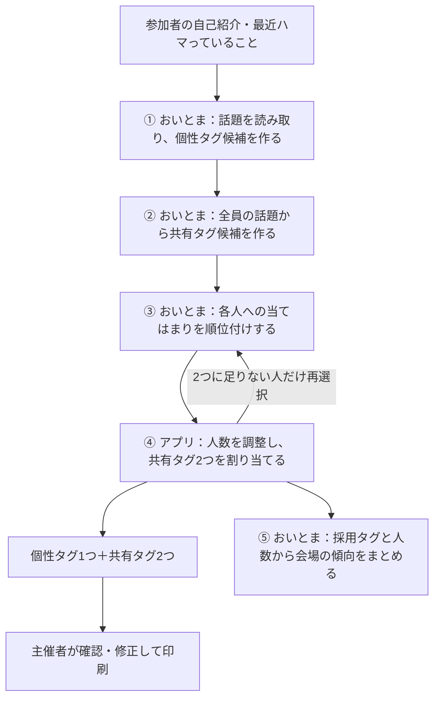

# 発表用：おいとまでタグを作る仕組み

2026-10-12時点の仕様・実装に基づく説明。文中の回答とタグは、仕組みを説明するための架空の例。

## 発表で伝える一文

**おいとまが「話しかけたくなる言葉」と「その人への当てはまり」を考え、アプリが人数を調整して、1人に個性タグ1つと共有タグ2つを付けます。**

個性タグは「それ、何ですか？」という質問の入口、共有タグは「私も同じです」という共通点の入口になることを目指しています。

## 読み上げ用の原稿

### 約30秒で説明する場合

> 自己紹介や最近ハマっていることを、おいとまが読み取り、話しかけたくなる短いタグにします。その人らしさを表す個性タグが1つ、ほかの参加者と共通点を見つける共有タグが2つです。言葉づくりと当てはまりの判断はおいとまが担当し、同じタグを持つ人数はアプリで調整しています。

### 約90秒で説明する場合

> タグは、参加者の自己紹介と「最近ハマっていること」から作ります。
>
> まず、おいとまが一人ひとりの回答から雑談の種を読み取り、その人らしい個性タグの候補を3つ作ります。
>
> 次に、全員の話題を見比べて、共有タグの候補を作ります。例えば、「ラーメン屋めぐり」と「カレー屋開拓」は、言葉は違っても食べ歩きという共通点があります。これを「ごはん屋開拓勢」のような、話しかけやすい言葉にまとめます。
>
> さらに、おいとまが各参加者に当てはまる共有タグを順位付けします。その結果を使って、アプリが人数を数え、少なすぎるタグを外したり、人数が集中したタグを別の候補に振り替えたりして、2つを割り当てます。
>
> こうして、個性タグで「それ、何ですか？」、共有タグで「私も同じです」という、2種類の会話の入口を作ります。最後に主催者が確認して修正でき、3枚の話題シールとして名札に貼れます。

## スライドに載せる要点

**タイトル案：おいとまが言葉を作り、アプリが共通点をつなぐ**

- 回答から雑談の種を読み取り、個性タグの候補を作る。
- 全員の似た話題をまとめ、共有タグの候補を作る。
- 各人への当てはまりを順位付けし、アプリが人数を調整する。
- 完成するのは、個性タグ1つ＋共有タグ2つの話題シール。

| 担当 | 行うこと | ねらい |
| --- | --- | --- |
| おいとま | 回答の意味を読み取り、言い換え、タグへの当てはまりを判断する | 初対面でも話しかけやすい言葉にする |
| アプリ | 人数を数え、共有タグを割り当て、形式や文字数を検証する | 共通点を持つ人が会場にいるように調整する |
| 主催者 | 回答とタグを見比べ、候補を選び直したり手で修正したりする | 印刷前に言葉と内容を確認する |

## 生成の流れ

| 段階 | 入力・処理 | 出力 |
| --- | --- | --- |
| ① 話題の読み取り | ID・所属・区分・自己紹介・一言を8人ずつ送る | 話題の要素1〜5個、個性タグ候補3個を依頼 |
| ② 共有タグ候補づくり | 全員のID・区分・話題の要素をまとめて送る | 人数に応じた共有タグ候補。最大40個 |
| ③ 当てはまり順 | 候補一覧と、各人の区分・話題・一言を15人ずつ送る | 通常は1人5候補を当てはまる順に選ぶ |
| ④ 割り当て | 上位2つを基本に、少人数のタグを外し、集中したタグを振り替える | 共有タグ2つと確認用のフラグ |
| ⑤ 会場の傾向まとめ | 採用タグのうち人数が多い上位8個と人数を送る | 会場の話題を紹介する2〜3文 |

個性タグは、使える候補の最初の1つを採用します。確認画面では別候補に変更でき、おいとまに別案を作ってもらうこともできます。⑤の紹介文が作れなくても、タグの結果は使えます。

## 回答がタグに変わる具体例

| 参加者 | 回答の例 | 読み取る話題の例 | 個性タグの例 | 共有タグの例 |
| --- | --- | --- | --- | --- |
| Aさん | カレー屋を開拓中です。最近ランニングを始めました | カレー屋めぐり、ランニング | カレー屋を開拓中 | ごはん屋開拓勢、体を動かしたい |
| Bさん | ラーメンの食べ歩きとサイクリングが好きです | ラーメン屋めぐり、サイクリング | サイクリング好き | ごはん屋開拓勢、体を動かしたい |

「カレー」と「ラーメン」のように回答の表現が違っても、意味の近い話題をまとめます。実際には会場全体の回答と人数も見て、共有タグを決めます。

40人の既定設定では、共有タグ候補を15個依頼し、1タグあたりの目安を8人、下限を4人、上限の目安を16人にします。上限は調整の目安で、当てはまる別候補がない場合などは超えることがあります。この数字は設定値であり、実際の生成結果や会話の実績ではありません。

## 質問されたときの補足

| 質問 | 回答 |
| --- | --- |
| なぜおいとまを使うのですか？ | 回答の表現が違っても意味の近さを判断し、研究や仕事の堅い説明を日常の会話に使える言葉へ言い換えるためです。 |
| タグの言葉はどう指示していますか？ | 「話しかけたくなる日常の言葉」「全角換算12文字以内」「回答に書かれていないことを事実として書かない」などをプロンプトに指定しています。家族・健康・恋愛・収入・宗教・政治・容姿・年齢の話題も使わないよう指示しています。 |
| 名前もおいとまに送りますか？ | 名前欄は送らず、参加者IDで処理します。同意なしの人は自己紹介と一言を空にして送ります。自由記述に含まれる人名を自動で匿名化する機能はありません。 |
| 生成がうまくいかなかったら？ | JSONを検証して再試行します。個性タグ候補が使えなければ「話しかけてね」にします。共有タグが足りなければおいとまに再選択させ、それでも足りない場合は人数の少ない採用タグで補って要確認にします。接続失敗などはエラーを表示し、保存された途中結果から再開できます。 |
| 内容の確認はできますか？ | 文字数や候補IDなどはプログラムで検証します。NG語、未回答、同意なし、代替作成などは確認用のフラグを付け、主催者が内容を確認・修正できます。 |
| 当日に1人追加しても作れますか？ | 追加した人の話題と個性タグを読み取り、すでに採用した共有タグから2つ選びます。既存参加者の割り当てはそのままです。 |
| デモでも本物のおいとまを使っていますか？ | liveではおいとまのAPIを呼びます。mockは通信せず疑似的に生成します。保存済み結果の再生は、その場で生成する処理とは別なので、実演時のモードに合わせて説明します。 |

## 実装を確認するための参照先

- [仕様書：タグ生成パイプライン](spec.md#タグ生成パイプライン)
- [追加仕様：1人分の生成](SPEC-ADD-1.md)
- [おいとまへの指示文](../src/lib/llm/prompts.ts)
- [5段階の生成を進める処理](../src/lib/pipeline/run.ts)
- [共有タグの人数調整](../src/lib/assign.ts)
- [人数から設定値を決める処理](../src/lib/sizing.ts)
- [個性タグの採用と確認用フラグ](../src/lib/pipeline/sticker.ts)
- [追加した1人の生成](../src/lib/pipeline/add-one.ts)
- [API通信・JSON検証・再試行・モード判定](../src/lib/llm/client.ts)
